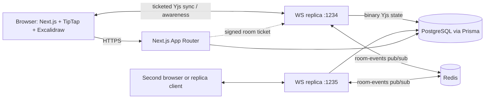

# Architecture

## Data ownership
- PostgreSQL: identity, workspace membership, pages metadata, comments, manual snapshots, and the
  binary Yjs update for each page (`YjsState`), flushed on a 1.5 s debounce, on idle eviction and at
  shutdown. This is what makes content survive a WebSocket process restart.
- Yjs document in each replica: live collaborative state for the rooms that replica holds, kept in
  step with the other replicas through Redis.
- Redis: transient fan-out only (`collabspace:room-events`, one channel, lib0-varint framed binary).
  Frames carry the publishing instance's id so a replica never re-applies its own update. Nothing is
  stored there; a room with no local client ignores the frames it receives.
- Re-authorization: every 15 s a replica compares its sockets against the membership table, so a
  removal or a demotion takes effect on an open connection instead of waiting for a reconnect.

## Collaboration model
Yjs is a CRDT. Concurrent edits are represented as commutative updates and merged by Yjs, so replicas converge independent of update arrival order. Awareness carries ephemeral user presence and cursor metadata; it is not durable document content.
